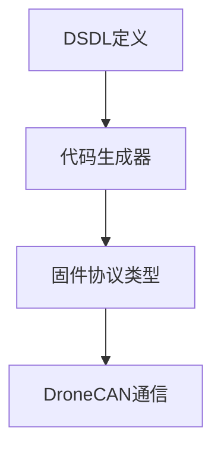

# DroneCAN 数据类型仓库架构

本文按本分支实际目录说明模块职责与依赖方向。具体时序、参数和验证结论以对应设计文档及源码为准。

## 源码与资料导航

| 位置 | 职责 |
| --- | --- |
| [uavcan](../uavcan) | 标准 UAVCAN/DroneCAN 数据类型命名空间 |
| [ardupilot](../ardupilot) | ArduPilot 扩展类型 |
| [com](../com) | 厂商类型命名空间 |
| [dronecan](../dronecan) | DroneCAN 扩展类型 |

## 维护边界

- 修改业务行为时同步相应设计和协议说明；原始硬件资料保留其来源和版本。
- 运行时模块、工具和验证数据分别维护，历史测试结果只适用于其记录的版本与条件。
- `.uavcan` 文件是协议输入；生成的 C/C++ 类型由使用方工程管理，不能将数据类型目录当成可独立运行的固件。

返回 [文档目录](README.md)。
